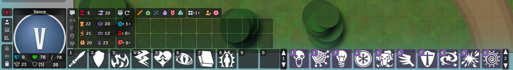
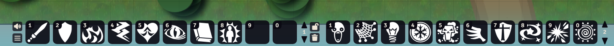
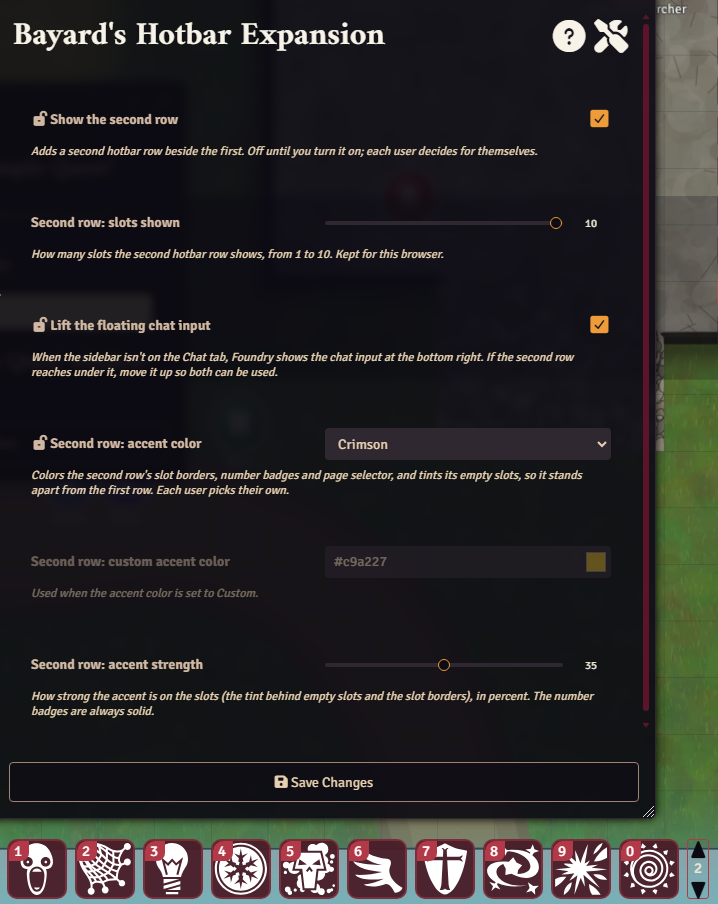
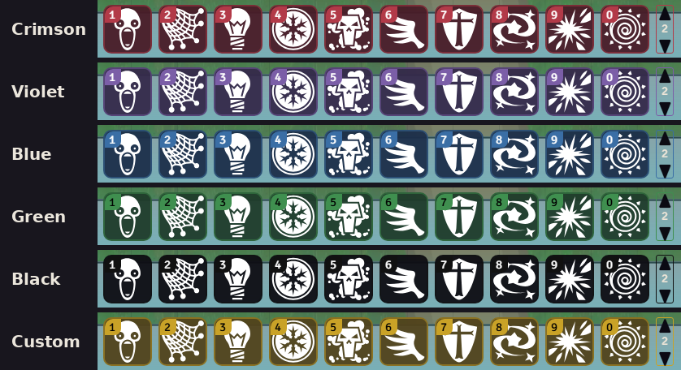
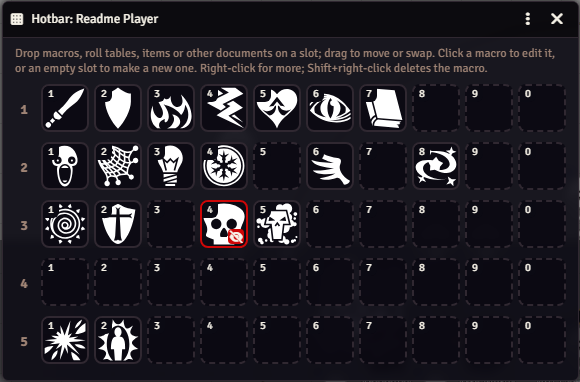

# Bayard's Hotbar Expansion

A second hotbar row beside the first. It shows any of the five hotbar pages, with its own page selector, its own keys, a slot count you choose and an optional accent color. It works with Foundry's own layout and with PF2e HUD's persistent HUD. For the GM, it also opens any user's whole hotbar for editing.

## What it looks like



**Inside PF2e HUD.** The second row, here on page 2 with the Violet accent, sits right after the first, styled the way the HUD styles the hotbar.



**Foundry's own layout.** Both rows side by side, with no accent: the second row looks like the first, with its own page selector.



**The settings.** Each user turns the row on for themselves. The accent color shows on the row while you pick it (Crimson here, not yet saved).



**Accent colors.** The five presets and a custom color; your own player color is the other choice.



**The GM's hotbar editor.** A player's five pages at once. The red border marks a macro the player can't run.

## Install

In Foundry, go to **Add-on Modules**, then **Install Module**, and paste this into **Manifest URL**:

```
https://github.com/Sir-Bayard/bayards-hotbar-expansion/releases/latest/download/module.json
```

Foundry's **Update** button then picks up each new release. You can also download `module.zip` from the [latest release](https://github.com/Sir-Bayard/bayards-hotbar-expansion/releases/latest) and unzip it into `Data/modules/bayards-hotbar-expansion`.

Requires Foundry VTT 14 (verified on 14.369). It works with any game system.

## What it does

Foundry keeps 50 hotbar slots per user, on five pages of ten, and shows one page at a time. This module adds a second row that shows another page at the same time.

**Turn it on:** the row is off until you tick "Show the second row" in **Configure Settings**, under this module. Each user (GM or player) decides for themselves, and the choice follows them to any computer. Turning it off puts everything back as it was.

- **It is the same hotbar.** The second row shows one of your five pages, so a macro on page 2 appears there and nowhere new is stored. Click to run, drop macros, items and actions onto it, drag between slots and between the rows, and right-click to edit or remove, just as on the first row. The hotbar lock applies to both.
- **Its own page.** The arrows beside the second row flip it through pages 1 to 5 without touching the first row. It starts on page 2 and remembers the page you leave it on, for your user on any computer.
- **Its own keys.** Alt+Shift+1 to Alt+Shift+0 run slots 1 to 10 of the second row. Change them in **Configure Controls**. (Alt+1 to 5 are Foundry's keys for switching the first row's page.)
- **Slot count.** Show 1 to 10 slots (setting "Second row: slots shown", kept per browser, since it depends on the screen). The keys follow: with six slots shown, Alt+Shift+7 does nothing.

## Accent color

To tell the rows apart at a glance, give the second row an accent color (setting "Second row: accent color"): Crimson, Violet, Blue, Green, Black, your player color, or a custom color you pick. It colors the slot borders, fills the number badges (with black or white numbers, whichever reads better), outlines the page selector and tints the empty slots (a macro's icon covers its slot). "Second row: accent strength" sets how strong the tint and borders are, from 10% to 60%. While the settings window is open, the second row shows the color and strength as you change them; close the window without saving and it goes back. Each user picks their own, and it follows them to any computer. The default is none, which looks like the first row.

## Where it sits

- **Foundry's layout:** both rows sit side by side, centered at the bottom of the screen.
- **PF2e HUD's persistent HUD:** the second row sits right after the first, inside the HUD, styled the way the HUD styles the first row.
- **Narrow screens:** the second row stays clear of the sidebar and (in Foundry's layout) of the player list. In Foundry's layout both rows first slide over into free space; if that isn't enough, the second row's slots get smaller, down to about half size. On a very narrow screen, or with PF2e HUD's middle placement on a narrow one, there may not be room for both rows even then; showing fewer slots helps.
- **The bottom right:** Foundry's floating chat input (shown when the sidebar isn't on the Chat tab) and panels docked under it, such as PF2e HUD's combat tracker, sit at the bottom of the right-hand column. If the second row reaches under that column, the column moves up so both can be used. With "Lift panels at the bottom right" turned off, the second row shrinks to stop before those panels instead (the chat input may then cover it).
- When the first row is hidden, so is the second.

## For the GM: edit a player's hotbar

Right-click a user in the Players list (bottom left) and choose **Edit hotbar**. A window shows all five pages of that user's hotbar, ten slots each.

- **Add:** drop a macro on a slot, from the Macros sidebar or a compendium (compendium macros are imported into the world). Roll tables become a "draw" macro, and anything else (an item, an actor, a journal entry) becomes a macro that opens its sheet, as on Foundry's own hotbar.
- **Move:** drag a macro to another slot or page. Dropping it on a filled slot swaps the two.
- **Edit:** click a macro to open it. Click an empty slot to make a new macro there (close it without giving it a name or command and it's removed again).
- **Remove or delete:** right-click a macro for Edit, Remove from slot (the macro stays in the world) and Delete. Shift+right-click deletes it straight away (Foundry still asks to confirm).
- **Sharing:** a player can run a macro they have at least Limited permission on (Limited hides its command from them). When you put a macro on a player's hotbar that they can't run, it is shared with them as Observer, and a note says so. A macro already on their hotbar that they can't run has a red border and an eye-slash mark. A macro made from an item or journal entry still needs the player to be able to open that document; you're warned when they can't.
- It updates as the player changes their own hotbar.

Only a GM can open it. It replaces the hotbar-editing part of the Macro Grid module.

## Other modules

The second row is built on Foundry's own hotbar, so modules that react when a hotbar is drawn (the `renderHotbar` hook) see it too. Interface themes use that to style both rows alike.

## Macros

`game.modules.get("bayards-hotbar-expansion").api`:

- `bar`: the second row. `bar.changePage(3)` shows page 3; `bar.page` is the page shown.
- `executeSlot(n)`: runs slot n (1 to 10) of the second row's page.

## Changes

See [CHANGELOG.md](CHANGELOG.md).

## How it was made

This module was written with Claude, Anthropic's AI assistant, directed and tested by its author at a real table. It is shared as is, for free.

## Problems and suggestions

Open an [issue](https://github.com/Sir-Bayard/bayards-hotbar-expansion/issues).

## License

[MIT](LICENSE). Copyright (c) 2026 Sir Bayard.

## Pathfinder

Bayard's Hotbar Expansion is an unofficial, free module for Foundry VTT. It is not published, endorsed or specifically approved by Paizo Inc. Pathfinder is a trademark of Paizo Inc., named here only because the module works alongside PF2e HUD, a module for the Pathfinder Second Edition system. The module contains no Paizo rules text, art or setting material.
