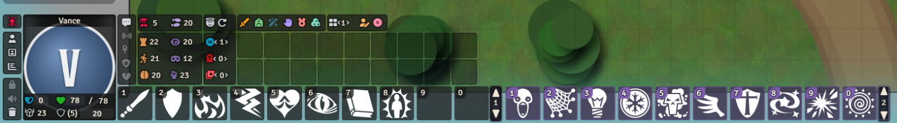
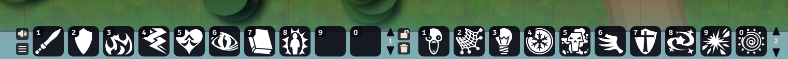
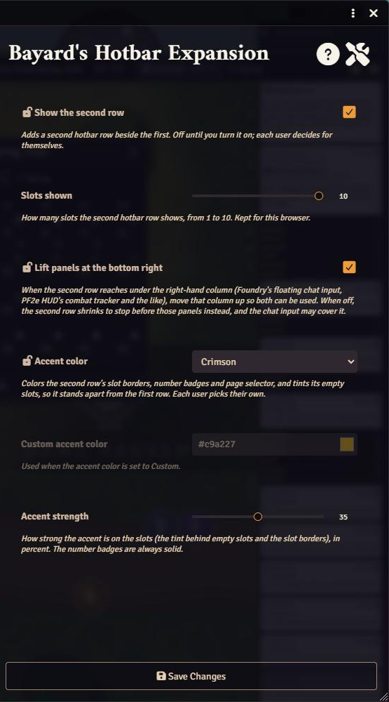
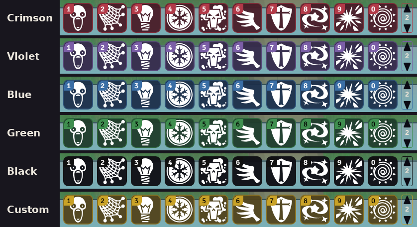
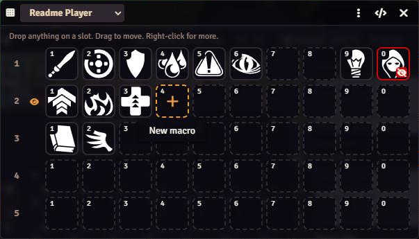

# Bayard's Hotbar Expansion

A second hotbar row beside the first. It shows any of the five hotbar pages, with its own page selector, its own keys, a slot count you choose and an optional accent color. It works with Foundry's own layout and with PF2e HUD's persistent HUD. For the GM, it also opens any user's whole hotbar for editing.

## What it looks like



**Inside PF2e HUD.** The second row on page 2, with the Violet accent, styled the way the HUD styles the hotbar.



**Foundry's own layout.** Both rows side by side, no accent.



**The settings.** Each user turns the row on for themselves. The accent shows on the row while you pick it.



**Accent colors.** The five presets and a custom color; your player color is the other choice.



**The GM's hotbar editor.** A player's five pages at once. The red border marks a macro the player can't run.

## Install

In Foundry, go to **Add-on Modules**, then **Install Module**, and paste this into **Manifest URL**:

```
https://github.com/Sir-Bayard/bayards-hotbar-expansion/releases/latest/download/module.json
```

Foundry's **Update** button then picks up each new release. You can also download `module.zip` from the [latest release](https://github.com/Sir-Bayard/bayards-hotbar-expansion/releases/latest) and unzip it into `Data/modules/bayards-hotbar-expansion`.

Requires Foundry VTT 14 (verified on 14.370). It works with any game system.

The second row is off until you turn it on: after enabling the module, each user who wants it ticks **Show the second row** in **Configure Settings**, under this module.

## What it does

Foundry keeps 50 hotbar slots per user, on five pages of ten, and shows one page at a time. The second row shows another page at the same time.

- **Each user decides.** GM or player, each turns it on for themselves, on any computer. Turning it off puts everything back.
- **The same hotbar.** Nothing new is stored. Click, drop, drag between slots and rows, and right-click, as on the first row. The hotbar lock applies to both.
- **Its own page.** Its arrows flip it through pages 1 to 5 without touching the first row. It starts on page 2 and remembers where you leave it.
- **Its own keys.** Alt+Shift+1 to Alt+Shift+0 run its slots (change them in **Configure Controls**). Alt+1 to 5 still switch the first row's page.
- **Slot count.** Show 1 to 10 slots ("Second row: slots shown", per browser).

## Accent color

An accent color tells the rows apart at a glance ("Second row: accent color"):

- It colors the slot borders, number badges and page selector, and tints the empty slots.
- Crimson, Violet, Blue, Green, Black, your player color or a custom color; "Second row: accent strength" sets 10% to 60%. The default, none, looks like the first row.
- It shows on the row as you change it in the settings window, and goes back if you close without saving. Each user picks their own.

## Where it sits

- **Foundry's layout:** both rows side by side, centered at the bottom.
- **PF2e HUD's persistent HUD:** right after the first row, styled to match.
- **Narrow screens:** the row slides over, then shrinks its slots to about half size, to stay clear of the sidebar and the player list. A very narrow screen may still not fit both; show fewer slots.
- **The bottom right:** when the row reaches under the right-hand column (the floating chat input, PF2e HUD's combat tracker), the column moves up. Turn off "Lift panels at the bottom right" to have the row shrink instead.
- When the first row is hidden, so is the second.

## For the GM: edit a player's hotbar

Right-click a user in the Players list and choose **Edit Hotbar**: a window with all five pages of their hotbar, updated as they change it. The name in the title bar switches to another user; the button beside it opens the Macro Directory.

- **Add:** drop a macro from the Macro Directory or a compendium (imported into the world). Anything else becomes a macro as it would on Foundry's hotbar: in Pathfinder 2e, strikes, actions, items, conditions and effects become PF2e's own macros; roll tables a draw macro; other documents a macro that opens their sheet.
- **Move:** drag to another slot or page; a filled slot swaps.
- **Edit:** click a macro to open it, or an empty slot to make one (closed with no name or command, it's removed again).
- **Remove or delete:** right-click for Edit, Remove from Slot (the macro stays in the world) and Delete. Shift+right-click deletes (Foundry asks first).
- **What it shares for you:** a player can run a macro they have Limited permission on. One you put on their hotbar that they can't run is shared with them as Observer, with a note. One already there that they can't run has a red border and an eye-slash mark.
- **What it can't fix:** a macro made from an item, a strike or a journal entry also needs the player to be able to open that item, character or entry. You're warned when they can't.

Only a GM can open it.

## Other modules

- The second row is Foundry's own hotbar underneath, so modules that react to `renderHotbar` (interface themes, say) see it too.
- The editor passes drops it doesn't handle to the `hotbarDrop` hook, so the game system builds its macros. A handler that writes the GM's hotbar directly, instead of calling `assignHotbarMacro`, can't place its macro from the editor.

## API

`game.modules.get("bayards-hotbar-expansion").api`:

- `bar`: the second row, or `null` while it's off. `bar.changePage(3)` shows page 3; `bar.page` is the page shown.
- `executeSlot(n)`: runs slot n (1 to 10) of the second row's page.
- `editHotbar(user)`: opens the GM's editor on a user (a User or a user id). GM only.

## Changes

See [CHANGELOG.md](CHANGELOG.md).

## How it was made

This module was written with Claude, Anthropic's AI assistant, directed and tested by its author at a real table. It is shared as is, for free.

## Problems and suggestions

Open an [issue](https://github.com/Sir-Bayard/bayards-hotbar-expansion/issues).

## License

[MIT](LICENSE). Copyright (c) 2026 Sir Bayard.

## Pathfinder

Bayard's Hotbar Expansion is an unofficial, free module for Foundry VTT. It is not published, endorsed or specifically approved by Paizo Inc. Pathfinder is a trademark of Paizo Inc., named here only because the module works alongside PF2e HUD, a module for the Pathfinder Second Edition system. The module contains no Paizo rules text, art or setting material.
